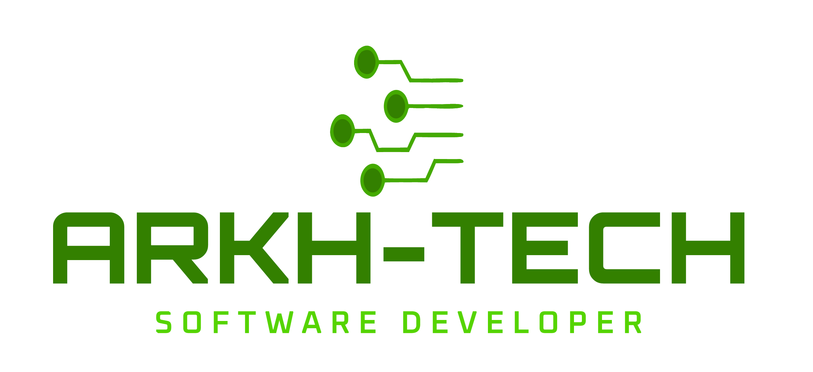

  

  # Arkh-Tech

  ### Software Developer · Soluções sob medida

  **Da ideia ao produto digital: tecnologia pensada para cada desafio.**

  Desenvolvemos soluções para **Web, Desktop e Mobile**, unindo engenharia de software, atenção aos detalhes e foco nas necessidades de cada projeto.

  [**Conheça nosso site**](https://arkhtech.com.br/) &nbsp;·&nbsp;
  [**Explore nossos projetos**](https://github.com/Arkh-Tech) &nbsp;·&nbsp;
  [**Entre em contato**](mailto:contato@arkhtech.com.br)

---

## 🚀 Quem somos

A **Arkh-Tech Software Developer** é uma empresa brasileira de desenvolvimento de software que transforma ideias, demandas e desafios em **soluções digitais sob medida**.

Atuamos na criação de sistemas e aplicações para diferentes plataformas, acompanhando a jornada de um produto desde o entendimento da necessidade até a sua entrega. Nosso compromisso é aproximar tecnologia e objetivos reais, com soluções que valorizam **qualidade, usabilidade e evolução**.

Para nós, um bom software vai além de funcionar: ele deve fazer sentido para quem usa, resolver problemas concretos e abrir espaço para novas possibilidades.

## 💻 O que fazemos

| Área | Como podemos ajudar |
| :-- | :-- |
| **🌐 Desenvolvimento Web** | Sites, sistemas e aplicações web responsivas, construídos conforme os objetivos do projeto. |
| **📱 Desenvolvimento Mobile** | Aplicativos para dispositivos móveis, com experiências pensadas para diferentes contextos de uso. |
| **🖥️ Desenvolvimento Desktop** | Sistemas para computadores voltados às necessidades de cada operação ou atividade. |
| **🧩 Soluções sob medida** | Projetos personalizados, da concepção à entrega, de acordo com requisitos e desafios específicos. |

## ✨ Nossa proposta

Cada projeto tem seu próprio contexto. Por isso, valorizamos uma abordagem que combina:

- **Entendimento do problema:** ouvir e compreender o que precisa ser resolvido antes de definir a solução.
- **Desenvolvimento com propósito:** selecionar caminhos técnicos que façam sentido para o produto e para seus usuários.
- **Qualidade e cuidado:** buscar aplicações claras, confiáveis e simples de utilizar.
- **Evolução contínua:** pensar em soluções preparadas para melhorias e novas necessidades.
- **Comunicação e parceria:** construir uma relação próxima entre quem idealiza e quem desenvolve.

## 🛠️ Projetos e iniciativas públicas

Além da apresentação institucional, você pode conhecer algumas iniciativas disponibilizadas pela Arkh-Tech no GitHub:

| Projeto | Descrição | Repositório |
| :-- | :-- | :-- |
| **Arkh Unique ID** | Biblioteca PHP para geração de identificadores únicos. | [Ver projeto](https://github.com/Arkh-Tech/arkh-unique-id) |
| **LinguaIA Coach** | Aplicação web para estudos de inglês com recursos de IA local por meio do Ollama. | [Ver projeto](https://github.com/Arkh-Tech/LinguaIA-Coach) |

> Os repositórios públicos representam iniciativas disponíveis no GitHub da organização e não uma lista completa de projetos comerciais.

## 🌍 Presença digital

- **Site oficial:** [arkhtech.com.br](https://arkhtech.com.br/)
- **GitHub:** [github.com/Arkh-Tech](https://github.com/Arkh-Tech)

## 📬 Vamos conversar?

Tem uma ideia, precisa desenvolver um sistema ou quer levar um projeto digital adiante?

A **Arkh-Tech** está à disposição para conversar sobre novos desafios e possibilidades de desenvolvimento.

- **E-mail:** [contato@arkhtech.com.br](mailto:contato@arkhtech.com.br)
- **Telefone / WhatsApp:** [+55 (15) 99647-0168](https://wa.me/5515996470168)
- **Site:** [https://arkhtech.com.br/](https://arkhtech.com.br/)

---

  <strong>Arkh-Tech · Software Developer</strong>
  
Ideias ganham forma quando encontram a tecnologia certa.

  © 2026 Arkh-Tech. Todos os direitos reservados.

