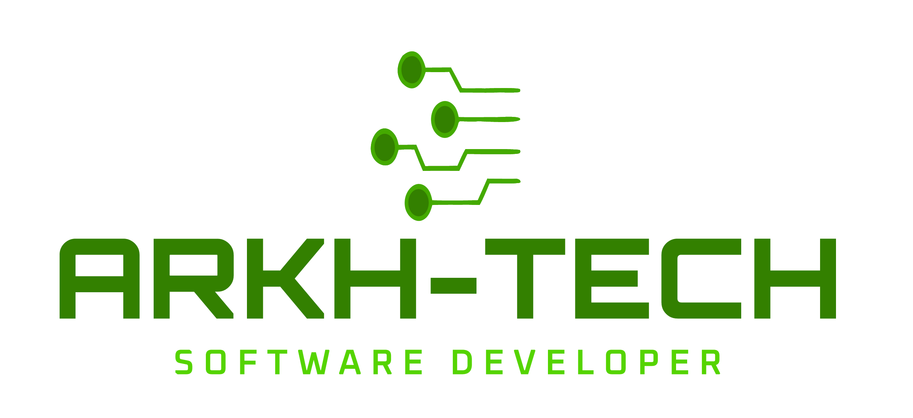

  

  # Arkh-Tech

  **Software Developer · Tailor-made Software Solutions**

  [🇬🇧 English](#english) &nbsp;|&nbsp; [🇧🇷 Português](#português)

---

  <h2 id="english">🇬🇧</h2>
 

  <h3>From ideas to digital products: technology built around every challenge.</h3>

  
We develop <strong>Web, Desktop, and Mobile</strong> solutions by combining software engineering, attention to detail, and a commitment to each project's unique needs.

  <a href="https://arkhtech.com.br/"><strong>Visit our website</strong></a> &nbsp;·&nbsp;
  <a href="https://github.com/Arkh-Tech"><strong>Explore our projects</strong></a> &nbsp;·&nbsp;
  <a href="mailto:contato@arkhtech.com.br"><strong>Get in touch</strong></a>

### 🚀 About us

**Arkh-Tech Software Developer** is a Brazilian software development company that turns ideas, requirements, and challenges into **tailor-made digital solutions**.

We create systems and applications for different platforms, supporting the product journey from understanding the initial needs to delivering the final solution. Our goal is to connect technology with real-world objectives through software that prioritizes **quality, usability, and long-term evolution**.

To us, great software goes beyond simply working: it should make sense to its users, solve real problems, and create new opportunities.

### 💻 What we do

| Area | How we can help |
| :-- | :-- |
| **🌐 Web Development** | Websites, systems, and responsive web applications tailored to each project's goals. |
| **📱 Mobile Development** | Mobile applications designed around different user needs and real-world scenarios. |
| **🖥️ Desktop Development** | Computer-based software solutions adapted to specific workflows and operational requirements. |
| **🧩 Custom Software Solutions** | Personalized projects, from initial concept to delivery, built around unique requirements and challenges. |

### ✨ Our approach

Every project has its own context. That is why we value an approach that combines:

- **Understanding the challenge:** listening carefully and identifying what really needs to be solved before defining a solution.
- **Purpose-driven development:** choosing technical approaches that make sense for the product and its users.
- **Quality and attention to detail:** building clear, reliable, and easy-to-use applications.
- **Continuous improvement:** developing solutions that can evolve alongside new needs and opportunities.
- **Communication and collaboration:** fostering a close working relationship between the people envisioning and building the product.

### 🛠️ Open-source projects and initiatives

Explore some of the initiatives shared by Arkh-Tech on GitHub:

| Project | Description | Repository |
| :-- | :-- | :-- |
| **Arkh Unique ID** | PHP library for generating unique identifiers. | [View project](https://github.com/Arkh-Tech/arkh-unique-id) |
| **LinguaIA Coach** | Web application for learning English with local AI capabilities powered by Ollama. | [View project](https://github.com/Arkh-Tech/LinguaIA-Coach) |

> These public repositories represent initiatives available on the organization's GitHub profile and are not a complete list of commercial projects.

### 🌍 Find us online

- **Official website:** [arkhtech.com.br](https://arkhtech.com.br/)
- **GitHub:** [github.com/Arkh-Tech](https://github.com/Arkh-Tech)

### 📬 Let's talk

Have an idea, need a new system, or want to bring a digital project to life?

**Arkh-Tech** is ready to discuss new challenges and software development opportunities.

- **Email:** [contato@arkhtech.com.br](mailto:contato@arkhtech.com.br)
- **Phone / WhatsApp:** [+55 (15) 99647-0168](https://wa.me/5515996470168)
- **Website:** [https://arkhtech.com.br/](https://arkhtech.com.br/)

  <strong>Arkh-Tech · Software Developer</strong>
  
Ideas take shape when they meet the right technology.

  © 2026 Arkh-Tech. All rights reserved.

---

  <h2 id="português">🇧🇷</h2>

  <h3>Da ideia ao produto digital: tecnologia pensada para cada desafio.</h3>

  
Desenvolvemos soluções para <strong>Web, Desktop e Mobile</strong>, unindo engenharia de software, atenção aos detalhes e foco nas necessidades de cada projeto.

  <a href="https://arkhtech.com.br/"><strong>Conheça nosso site</strong></a> &nbsp;·&nbsp;
  <a href="https://github.com/Arkh-Tech"><strong>Explore nossos projetos</strong></a> &nbsp;·&nbsp;
  <a href="mailto:contato@arkhtech.com.br"><strong>Entre em contato</strong></a>

### 🚀 Quem somos

A **Arkh-Tech Software Developer** é uma empresa brasileira de desenvolvimento de software que transforma ideias, demandas e desafios em **soluções digitais sob medida**.

Atuamos na criação de sistemas e aplicações para diferentes plataformas, acompanhando a jornada de um produto desde o entendimento da necessidade até a sua entrega. Nosso compromisso é aproximar tecnologia e objetivos reais, com soluções que valorizam **qualidade, usabilidade e evolução**.

Para nós, um bom software vai além de funcionar: ele deve fazer sentido para quem usa, resolver problemas concretos e abrir espaço para novas possibilidades.

### 💻 O que fazemos

| Área | Como podemos ajudar |
| :-- | :-- |
| **🌐 Desenvolvimento Web** | Sites, sistemas e aplicações web responsivas, construídos conforme os objetivos do projeto. |
| **📱 Desenvolvimento Mobile** | Aplicativos para dispositivos móveis, com experiências pensadas para diferentes contextos de uso. |
| **🖥️ Desenvolvimento Desktop** | Sistemas para computadores voltados às necessidades de cada operação ou atividade. |
| **🧩 Soluções sob medida** | Projetos personalizados, da concepção à entrega, de acordo com requisitos e desafios específicos. |

### ✨ Nossa proposta

Cada projeto tem seu próprio contexto. Por isso, valorizamos uma abordagem que combina:

- **Entendimento do problema:** ouvir e compreender o que precisa ser resolvido antes de definir a solução.
- **Desenvolvimento com propósito:** selecionar caminhos técnicos que façam sentido para o produto e para seus usuários.
- **Qualidade e cuidado:** buscar aplicações claras, confiáveis e simples de utilizar.
- **Evolução contínua:** pensar em soluções preparadas para melhorias e novas necessidades.
- **Comunicação e parceria:** construir uma relação próxima entre quem idealiza e quem desenvolve.

### 🛠️ Projetos e iniciativas públicas

Além da apresentação institucional, você pode conhecer algumas iniciativas disponibilizadas pela Arkh-Tech no GitHub:

| Projeto | Descrição | Repositório |
| :-- | :-- | :-- |
| **Arkh Unique ID** | Biblioteca PHP para geração de identificadores únicos. | [Ver projeto](https://github.com/Arkh-Tech/arkh-unique-id) |
| **LinguaIA Coach** | Aplicação web para estudos de inglês com recursos de IA local por meio do Ollama. | [Ver projeto](https://github.com/Arkh-Tech/LinguaIA-Coach) |

> Os repositórios públicos representam iniciativas disponíveis no GitHub da organização e não uma lista completa de projetos comerciais.

### 🌍 Presença digital

- **Site oficial:** [arkhtech.com.br](https://arkhtech.com.br/)
- **GitHub:** [github.com/Arkh-Tech](https://github.com/Arkh-Tech)

### 📬 Vamos conversar?

Tem uma ideia, precisa desenvolver um sistema ou quer levar um projeto digital adiante?

A **Arkh-Tech** está à disposição para conversar sobre novos desafios e possibilidades de desenvolvimento.

- **E-mail:** [contato@arkhtech.com.br](mailto:contato@arkhtech.com.br)
- **Telefone / WhatsApp:** [+55 (15) 99647-0168](https://wa.me/5515996470168)
- **Site:** [https://arkhtech.com.br/](https://arkhtech.com.br/)

  <strong>Arkh-Tech · Software Developer</strong>
  
Ideias ganham forma quando encontram a tecnologia certa.

  © 2026 Arkh-Tech. Todos os direitos reservados.

